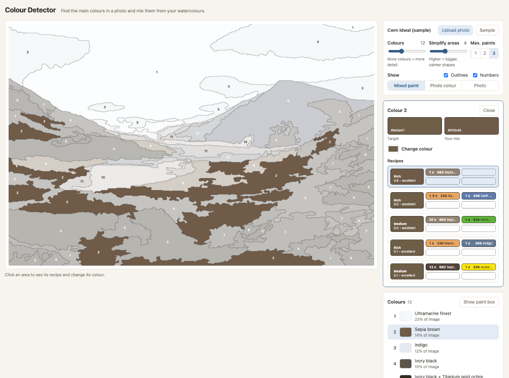

# Colour Detector

Finds the main colours in a photo, works out how to mix each one from your own watercolours, and shows the photo as flat, numbered colour areas — a paint-by-numbers plan for a watercolour.



Everything runs in the browser. There is no backend, no account and no upload: the photo never leaves your machine.

## Features

- **Colour areas:** the photo is reduced to 2–32 main colours and drawn as flat, numbered areas. A second slider simplifies the shapes into bigger, calmer areas.
- **Recipes:** for every colour, up to five ways to mix it from the paints in your box — which paints, in what ratio, how much water, and how close the mix gets.
- **Paint box:** every paint is a chip in its own colour. The paints you have selected sit in a box at the top; the rest are listed below, under Pans and Tubes, each sorted by colour family and number. Click a chip to move it between the two. "Auto" proposes the paints that suit the current picture. The selection is remembered in the browser.
- **Limits:** restrict mixes to one, two or three paints.
- **Recolour:** click an area, pick a different target colour, choose between the alternative recipes, or detach a single area from the others that share its colour.
- **Views:** mixed paint, photo colour or the original photo, with outlines and numbers on or off.

## Match quality

Each recipe shows a number and a rating, for example `0.8 • excellent`. The number is ΔE, the distance between the target colour and the mixed colour in the OKLab colour space, multiplied by 100. It has no unit; one step is roughly the smallest difference the eye can notice, and white against black is about 100.

| ΔE | Rating |
|---|---|
| below 2 | excellent |
| below 5 | good |
| below 10 | fair |
| 10 and above | rough |

## How the mixing works

Watercolour is a transparent glaze on white paper, so each paint is modelled as a filter: its reference colour gives a per-channel absorbance `A = −ln(reflectance)`, and a mix of paints with amounts `aᵢ` reflects `exp(−Σ aᵢ·Aᵢ)` (Beer–Lambert). Finding a recipe is a non-negative least-squares fit in absorbance space over all 1-, 2- and 3-paint combinations, followed by a perceptual refinement in OKLab. The total amount maps to the water level, from a very watery wash to concentrated.

## The paint stock

The stock is hard-coded in `src/data/paints.js`: 53 Schmincke Horadam Aquarell paints (pans and tubes) and one Michael Harding tube. Each paint has a `hex` value, which is its colour at strength 1 — a mid-strength wash on white paper, not the masstone. Most values were sampled from the official Horadam colour chart; a few are estimates and are marked as such in the data.

To use your own paints today, edit that file. A UI for adding paints from other vendors is planned (TASK-11 in the backlog).

## Develop

Requires Node 18 or newer.

```bash
npm install
npm run dev     # http://localhost:5173
npm test        # Vitest
npm run build   # → dist/
```

The build uses a relative base path, so `dist/` works from any folder on any static host.

## Project layout

| Path | Contents |
|---|---|
| `src/lib/` | Pure logic, framework-free and tested: colour maths, mixing model, segmentation, paint grouping |
| `src/stores/` | Pinia stores: `paints` (stock and enabled set) and `analysis` (image, settings, areas, recipes) |
| `src/components/` | Vue 3 components (`<script setup>`) |
| `src/workers/` | Web Worker for the segmentation |
| `src/css/` | Plain CSS, BEM, one file per block |
| `src/data/paints.js` | The paint stock |
| `deploy/` | GitHub webhook and deploy script for the server |

Stack: Vue 3, Pinia, Vite 5, Vitest.

Spec: [`PRD_ColourDetector_v1.0.0.md`](PRD_ColourDetector_v1.0.0.md) · Backlog: [`docs/backlog.md`](docs/backlog.md)

## Deploy

The app is meant to run at https://markus-freise.de/colour-detective/. That address is not set up yet (TASK-09 in the backlog).

The intended flow: pushing to `main` triggers a GitHub webhook. `webhook.php` checks the signature and starts `deploy/deploy.sh` (git pull → `npm ci` → `npm run build` → rsync `dist/` into the web root).

One-time setup on the server (SSH):

```bash
git clone git@github.com:markusfreise/colour-detector.git ~/colour-detector   # private repo: needs a deploy key
bash ~/colour-detector/_bootstrap/bootstrap-server.sh /path/to/markus-freise.de/colour-detective
```

The script creates `webhook-config.php` with a random secret, runs the first build and prints the values for GitHub → Settings → Webhooks:

| Field | Value |
|---|---|
| Payload URL | `https://markus-freise.de/colour-detective/webhook.php` |
| Content type | `application/json` |
| Secret | printed by the script |
| Events | Just the push event |

Requirements on the host: git, Node 18 or newer with npm (nvm is picked up), rsync, `flock`, and PHP with `exec()` enabled. `webhook-config.php` holds the secret and is never committed.
